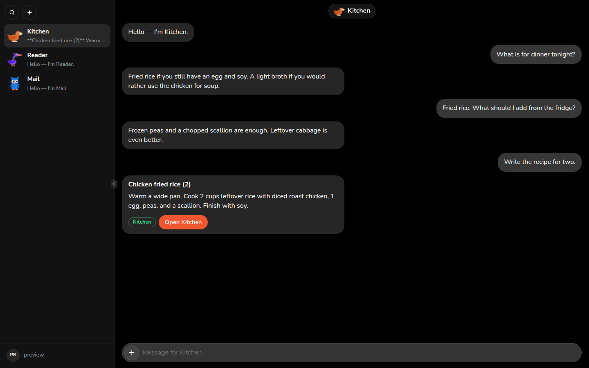
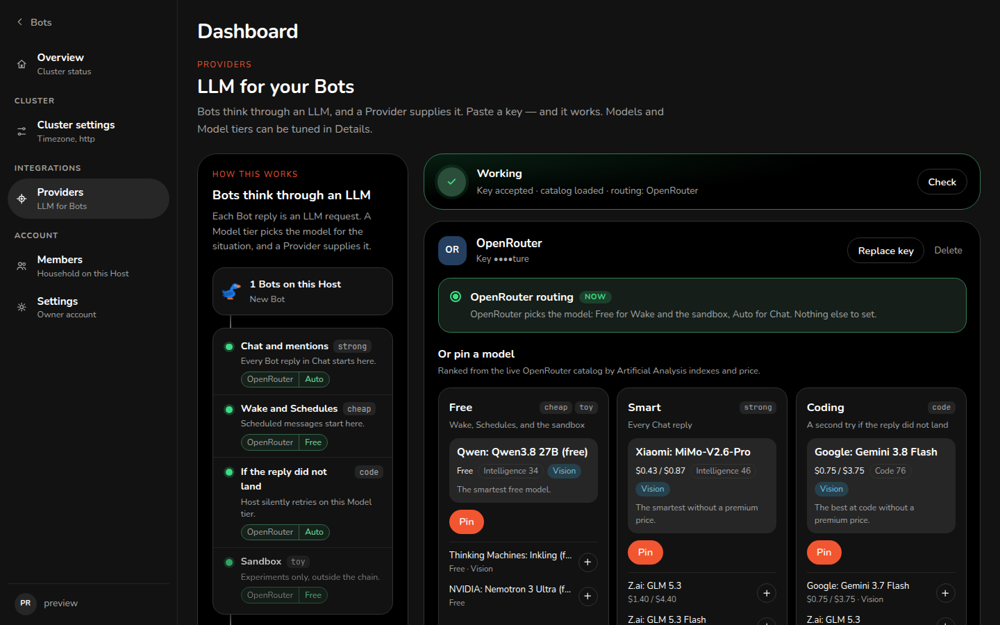

# Dostigus 🪿

A cloud dev factory. The business sees Tasks, a Grill, proofs, and two buttons, Approve and Release. One Architect per Project runs the repo, the Builders, and the deploy. Direction: [`docs/vision.md`](docs/vision.md), [`docs/mvp.md`](docs/mvp.md), [ADR 0049](docs/adr/0049-dev-factory-direction.md).

The Host that runs today is still Chat, Bots, and Dashboard on one Cluster. Projects and Runs are the next slices, not this checkout's behavior yet. Self-host compose remains possible. The factory's default is the cloud Host on de2.



*Kitchen thread on a lived-in Host, with Mail and Reader in the sidebar.*



*Dashboard → Providers: an OpenRouter key on the shelf, with Model tiers and the live catalog.*

## Why

The factory keeps the business on one Bot and the repo work on Builders, with a Grill before code and Gates before merge and deploy. The running Cluster is still **your Host**: a SQLite **Store** and **your** keys. Grok Bot can be the external Architect. It is not a second product.

You run a **Cluster**. You add Members to your **Collective**. Bots talk through an **MCP surface** against that Store. You pick **Providers** — OpenRouter first, plus OpenAI and OpenAI-compatible — and bind **Model tiers** instead of baking a model list into the repo.

Day-1 the Host can **Export Pack** from a live Bot and **Apply** from a local file, a public `.zip` URL, or an https git remote (preview, then write onto a Bot). That is not an in-product Marketplace. Public Marketplace is the marketing-site catalog (https://dostigus.ru/marketplace; Host out-link). Listings live in the Catalog Store on dostigus.ru (`dostigus/cloud`; public read API + Nick publish; [docs/catalog.md](docs/catalog.md)); the Host does not pull a catalog and does not run that Store. Module packages as a Marketplace kind stay later.

## What you get

- **Cluster** — one Collective’s running instance: Store, Bots, and settings. Not the git repo.
- **Host** — the client app: Chat, Cards, and Sheets from the Kit.
- **Bot** — a long-lived persona with Skills and MCP access. A Bot is not a Module package.
- **Pack** — a portable recipe you Export from a Bot or Apply from a local file. Not a Bot and not a Module package.
- **Skill** — instructions a Bot follows. Not executable UI.
- **Schedule** — a Store row that says when the Host wakes a Bot.
- **Artifact** — a persisted Cluster file (upload or Bot put), joined onto a Chat line.
- **Provider** — an Owner-connected LLM gateway instance (OpenRouter, OpenAI, or OpenAI-compatible).
- **Model tier** — `cheap` / `strong` / `code` (plus `toy`): each binds to a Provider + Policy.
- **Collective** — the Owner, Admins, and Members on one Cluster. Plain chats may carry a Case. Project work is a Task.
- **MCP surface** — the tools a Bot (and the Host) use to read and write the Store.
- **Project, Architect, Task, Builder, Run** — the factory nouns. Defined in [`CONTEXT.md`](CONTEXT.md). Not shipped in this Host yet.

## Quick start

The factory runs at `dostigus.kosarev.space`. Self-host remains possible:

```bash
docker compose -f docker/compose.yml up --build
```

Open [http://localhost:3000/](http://localhost:3000/). Create the Owner. In **Dashboard → Providers**, add an OpenRouter (or other) key. Env, Store volume, and MCP token: [`docs/deploy.md`](docs/deploy.md).

### Develop

```bash
pnpm install
pnpm --filter @dostigus/web dev   # http://localhost:3000/
CI=1 pnpm check
```

Preview seed, smoke, and `pnpm shoot:preview` live in [`AGENTS.md`](AGENTS.md).

## Architecture

The **Platform** is this git monorepo. A **Cluster** is a running instance plus its Store. They are not the same thing.

The Host renders Kit Chat, Cards, and Sheets. Bots call the MCP surface against the Store. The LLM gateway is Providers + Policy + Model tiers ([ADR 0036](docs/adr/0036-llm-providers-tier-resolve-escalate.md)).

Scope: [`docs/SPEC.md`](docs/SPEC.md). Glossary: [`CONTEXT.md`](CONTEXT.md). Decisions: [`docs/adr/`](docs/adr/).

## Status

Early. Direction is the dev factory ([ADR 0049](docs/adr/0049-dev-factory-direction.md)). The cloud Host on de2 is the factory run. Compose remains possible. MIT.

Day-1 Host **Export Pack** / **Apply** from file, public URL, or git (preview → Bot). Public Marketplace is the marketing-site catalog (Host out-link). Listings live in the Catalog Store on dostigus.ru; the Host does not pull a catalog and does not run that Store. Module packages as a Marketplace kind stay later. This Host already runs Chat, Skills, Schedules, Artifacts, and Collective Members. Do not read that as a store you browse and install. See [`docs/SPEC.md`](docs/SPEC.md).

## License

[MIT](LICENSE)
